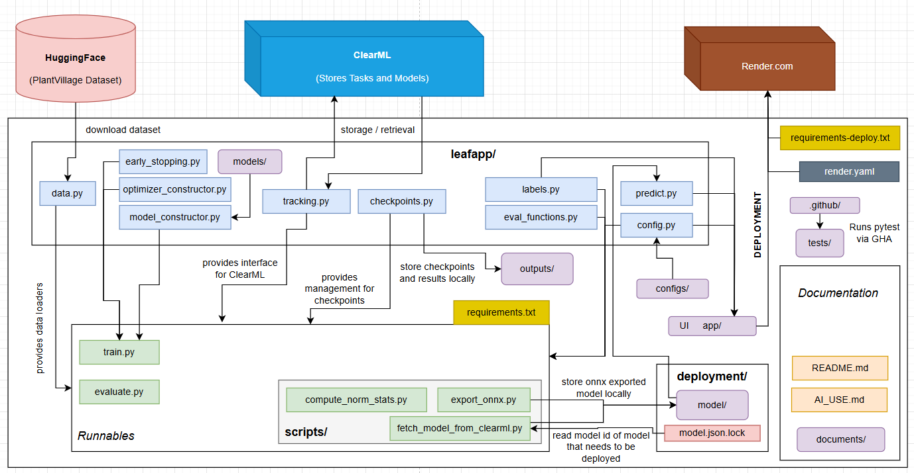

# Architecture

Explains the project structure and how its components connect.

---

## 1. Overview

<!-- 2–4 sentences: leaf image in → disease label out, and the main parts. -->

### High-level diagram

---

## 2. Repository layout

| Path | Purpose |
|------|---------|
| `leafapp/` | Serves as a core library for the shared code used by training, evaluation, the scripts and the app: config loading, data loading and splitting, labels, model and optimiser construction, early stopping, checkpoints, metrics, ClearML tracking and prediction |
| `leafapp/models/` | Defines the model architectures: `BasicCNN` (`cnn.py`), the regularised CNN with batch norm, dropout and pooling options (`regularised_cnn.py`) and ResNet18 (`resnet.py`) |
| `configs/` | Holds configuration files for model training. Includes settings for processing data, defining model type and its hyperparameters |
| `train.py` | Entry point for training. Trains and validates a model from a config file, logs the run to ClearML and saves checkpoints |
| `evaluate.py` | Entry point for evaluation. Evaluates a checkpoint (local or from a ClearML task) on the validation or test split and produces metrics, a confusion matrix, training curves and a report |
| `compute_norm_stats.py` | One-off script that computes the per-channel mean and std of the PlantVillage training split, used for the `plant_village` normalisation option |
| `scripts/` | Supporting runnable scripts: exporting a checkpoint to ONNX and uploading it to ClearML (`export_onnx.py`), downloading the pinned deployment model (`fetch_model_from_clearml.py`) and saving the gallery images (`save_example_images.py`) |
| `app/` | Defines the Gradio UI that serves predictions from the deployed ONNX model, plus the example image gallery (`app/gallery/`) |
| `deployment/` | Holds `model.lock.json`, which sets the ClearML ID of the model to deploy, and the scripts for running the app locally. The downloaded model goes into `deployment/model/`, which is git-ignored |
| `render.yaml` | Render service configuration for the cloud deployment |
| `requirements.txt` / `requirements-deploy.txt` | Full dependencies for development and training / reduced dependencies for running the app (no torch) |
| `pyproject.toml` | Test coverage settings (measures `leafapp/` and `app/`) |
| `tests/` | Contains pytests for `leafapp/`, `app/`, the `train.py` and `evaluate.py` entry points and the ONNX export script |
| `.github/workflows/` | CI workflows: `tests.yml` runs the test suite, and `deploy-check.yml` checks the deployment install has no torch, fetches the pinned model and checks the app can predict with it |
| `notebooks/` | Exploratory work |
| `documents/` | Project documentation: experiment write-ups (`experiments/`), meeting summaries (`meetings/`), the AI use statement and this file |
| `outputs/` | Generated locally by training and evaluation (checkpoints, reports, diagrams). Git-ignored |

---

## 3. Components

One or two lines each: what it does and the key choices.

| Component | Files | Description |
|-----------|-------|-------------|
| Config | `leafapp/config.py`, `configs/` | |
| Data pipeline | `leafapp/data.py`, `leafapp/labels.py` | |
| Models | `leafapp/models/`, `leafapp/model_constructor.py` | |
| Training | `train.py`, `leafapp/optimizer_constructor.py`, `leafapp/early_stopping.py`, `leafapp/checkpoints.py` | |
| Evaluation | `evaluate.py`, `leafapp/eval_functions.py` | |
| Experiment tracking | `leafapp/tracking.py` | |
| Inference | `leafapp/predict.py` | |
| Web app | `app/` | |
| Deployment | `render.yaml`, `deployment/`, `scripts/`, `.github/workflows/` | |

---

## 4. Data flow

**Training:** <!-- config → data → model → train loop → tracking → checkpoint -->

**Evaluation:**

**Prediction:** <!-- upload → preprocessing → model → label + confidence → UI -->

---
