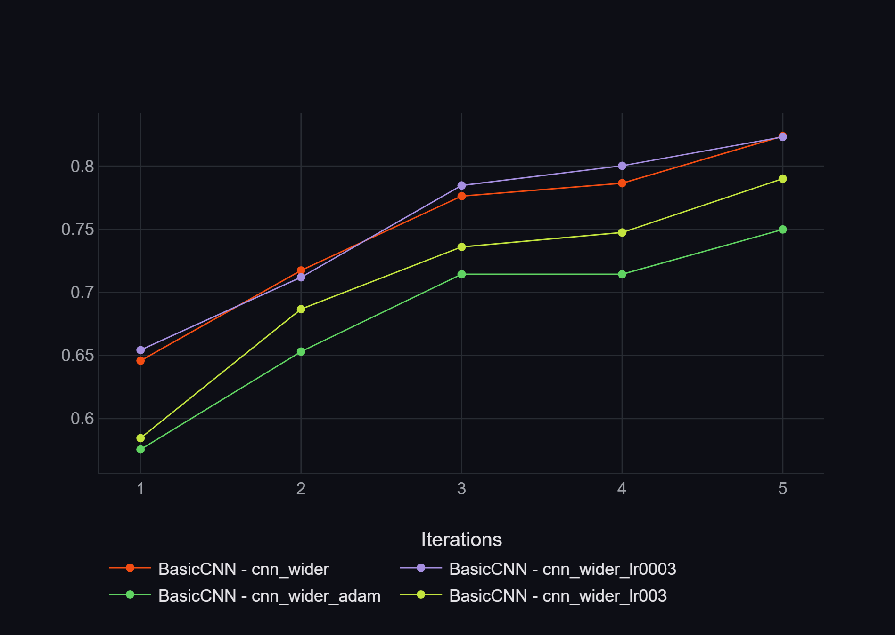
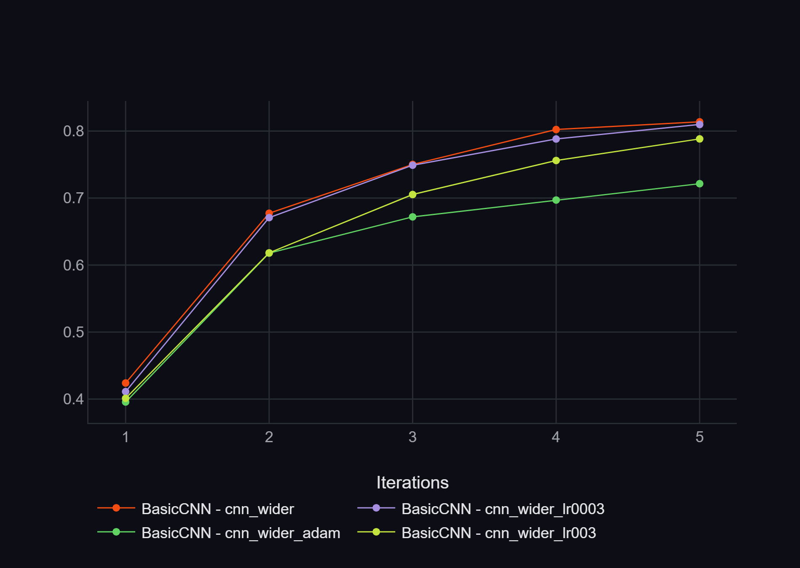
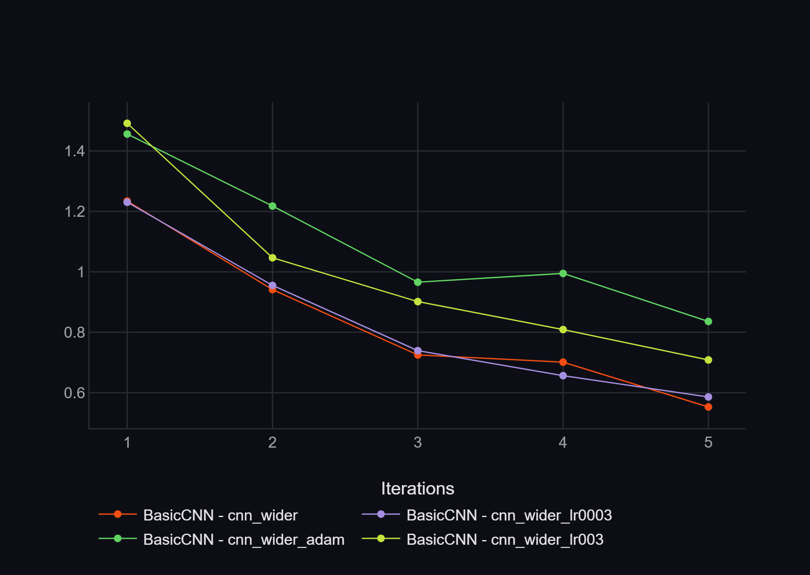

# SGP-27: Optimiser and Learning Rate Comparison

## Purpose
Justify the optimiser used for the BasicCNN (compulsory requirement, point 11) and check that the learning rate we use is a sensible choice.
The optimiser is now a config option (`train.optimizer`, default `AdamW`), so these runs only differ in their config files.

## Setup
All runs use the wider CNN (`channels: [32, 64, 128]`), which the team agreed as the base model, with the same settings:
- 20% of PlantVillage (`fraction: 0.2`), image size 128, batch size 32
- 5 epochs, weight decay 0.01, seed 42

Each config changes exactly one setting from the reference run (`cnn_wider.yaml`: AdamW, lr 0.001), so any difference in the results comes from that setting.

| Config | Optimiser | Learning rate | Changed from reference |
|---|---|---|---|
| `cnn_wider.yaml` | AdamW | 0.001 | (reference) |
| `cnn_wider_adam.yaml` | Adam | 0.001 | optimiser |
| `cnn_wider_lr0003.yaml` | AdamW | 0.0003 | learning rate |
| `cnn_wider_lr003.yaml` | AdamW | 0.003 | learning rate |

All four runs are logged in ClearML (project `Plant-Disease-Image-Classification`). The charts in this document were exported from ClearML's task comparison view; the training and validation curves for loss, accuracy and macro F1 are all in this folder.

## Results (validation set, epoch 5)

| Config | Train acc | Val acc | Val F1 (macro) | Val loss | ClearML task |
|---|---|---|---|---|---|
| `cnn_wider.yaml` | 0.814 | **0.824** | 0.765 | **0.553** | `04be20a0b766427e8c0bb19107e1da67` |
| `cnn_wider_adam.yaml` | 0.721 | 0.750 | 0.661 | 0.836 | `77e8908db1e24deb90bb11d459ba2c50` |
| `cnn_wider_lr0003.yaml` | 0.810 | 0.823 | **0.770** | 0.586 | `2f4b2101daf54206b825a9f44f7562d2` |
| `cnn_wider_lr003.yaml` | 0.788 | 0.790 | 0.736 | 0.708 | `dfc1ab9a531443c9be512b0588a08af7` |

The reference run reproduces Nil's earlier `cnn_wider.yaml` run from SGP-15 (val accuracy 0.824 vs 0.827), so differences of a few tenths of a point between runs are within run-to-run noise.

## Optimiser: AdamW vs Adam
- With identical settings, AdamW reached 0.824 validation accuracy and Adam 0.750, a gap of 7.4 points (macro F1: 0.765 vs 0.661). This is far larger than the ~0.3 point difference between two identical runs, so it is a real difference rather than noise.
- The two optimisers differ only in how they apply weight decay. Adam adds weight decay to the gradient (L2 regularisation), and that combined gradient is then rescaled separately for every weight by Adam's adaptive learning rates, so the effective amount of decay is different for each weight. AdamW applies weight decay directly to the weights, separately from the gradient step (decoupled weight decay), so every weight is shrunk by the same proportion and `weight_decay: 0.01` means what it says.
- Adam's training accuracy is also lower (0.721 vs 0.814) with no gap opening between training and validation. Low training and validation accuracy together point to underfitting, which fits the explanation that Adam's distorted weight decay holds the model back, rather than the model overfitting.
- AdamW was proposed for exactly this reason: L2 regularisation does not behave like weight decay in adaptive optimisers such as Adam (Loshchilov & Hutter, *Decoupled Weight Decay Regularization*, ICLR 2019).
- The curves below show that Adam (green) stays below the AdamW runs at every epoch, on training and validation accuracy alike, so the gap is not a one-off at the final epoch.





**Decision:** keep AdamW as the optimiser for BasicCNN.

## Learning rate
- lr 0.0003 and lr 0.001 performed the same within noise (val accuracy 0.823 vs 0.824, macro F1 0.770 vs 0.765).
- lr 0.003 was clearly worse (0.790 val accuracy, 3.4 points below lr 0.001).
- The validation loss of both lr 0.0003 and lr 0.001 was still dropping at epoch 5, so their ranking could change with more epochs.



**Decision:** keep lr 0.001. It is as good as 0.0003 after 5 epochs, and it is the value the rest of the team's experiments use.

## Limitations
- Each result comes from a single run with one seed, on 20% of the data and for 5 epochs.
- The comparison changes one setting at a time from the reference run. It assumes the best learning rate is similar for Adam and AdamW, which is reasonable as the two optimisers are very similar, but Adam was only tested at lr 0.001.
- SGD was not compared, because it needs its own tuning (a larger learning rate and a momentum setting) to be a fair comparison.

## Possible further work
- Run Adam with `weight_decay: 0`. If the gap to AdamW mostly closes, that would confirm weight decay as the cause.
- Run Adam at its own best learning rate, to rule out lr 0.001 simply suiting AdamW better.
- Repeat the lr 0.0003 vs 0.001 comparison for more epochs or with full data.

## Reproducing
```bash
python train.py --config configs/cnn_wider.yaml
python train.py --config configs/cnn_wider_adam.yaml
python train.py --config configs/cnn_wider_lr0003.yaml
python train.py --config configs/cnn_wider_lr003.yaml
```
