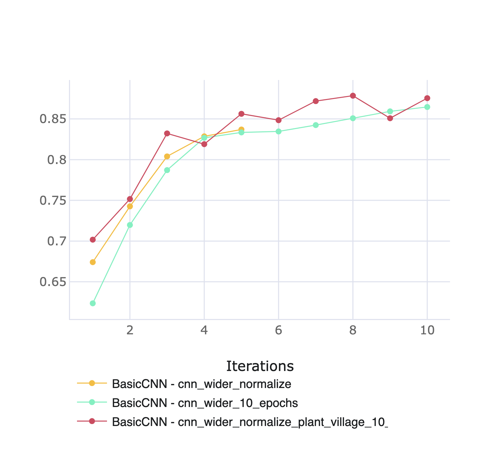
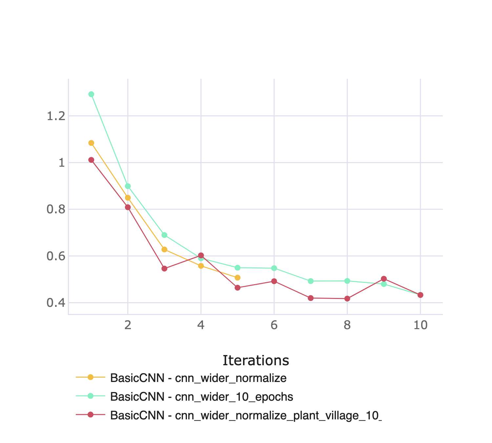
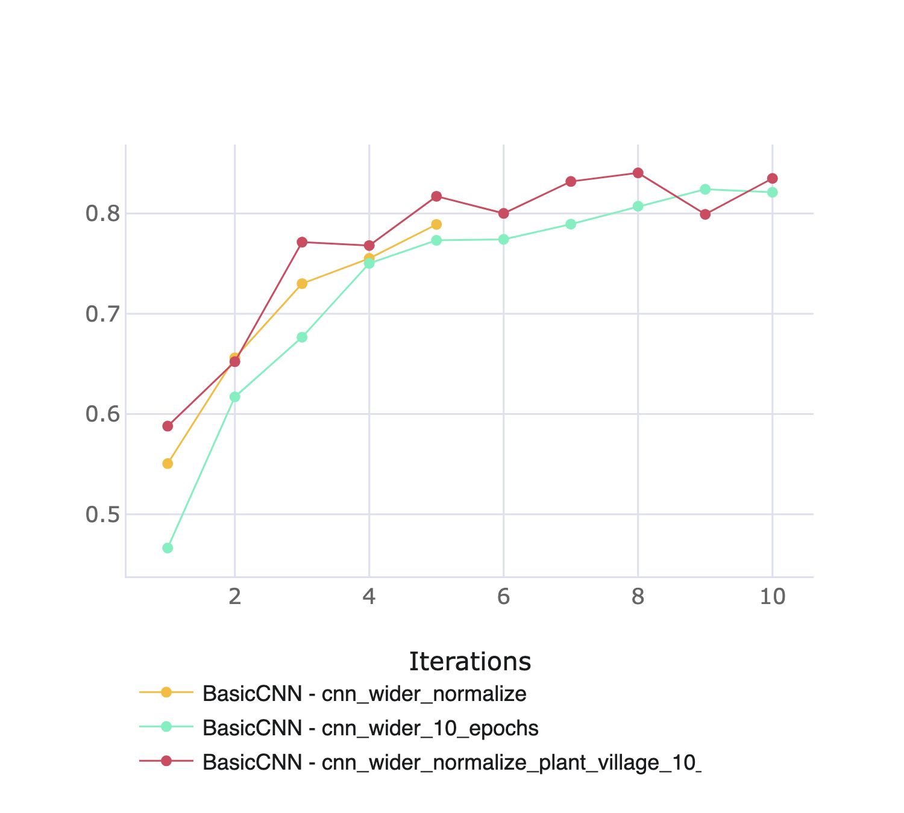

# SGP-31: Image Normalisation Comparison

## Purpose
The main objective of the experiment is to explore what effect normalising the images has on the wider CNN, and whether ImageNet's or our own dataset's numbers work better.

## Setup
All runs use the wider CNN (`channels: [32, 64, 128]`) with the same settings:
- 20% of PlantVillage (`fraction: 0.2`), image size 128, batch size 32
- AdamW, lr 0.001, weight decay 0.01, seed 42

Only `data.normalize` changes between runs:

| normalize | Mean (R, G, B) | Std (R, G, B) |
|---|---|---|
| `false` | none | none |
| `imagenet` | 0.485, 0.456, 0.406 | 0.229, 0.224, 0.225 |
| `plant_village` | 0.4671, 0.4897, 0.4125 | 0.1914, 0.1669, 0.2109 |

For a deeper comparison, `compute_norm_stats.py` computes the plant_village numbers: the mean and std of each colour over the training split only (fraction 0.2, seed 42) with augmentation off. 

All runs are logged in ClearML (project `Plant-Disease-Image-Classification`). The charts below were exported from ClearML's comparison view.

## Results (validation set)
| Run | Config | normalize | Epochs | Best epoch (val loss) | Val acc | Val F1 | Val loss | ClearML task |
|---|---|---|---|---|---|---|---|---|
| Plain | `cnn_wider_10_epochs.yaml` | `false` | 10 | 10 | 0.865 | 0.821 | 0.433 | `3eb8dd20870549ff9f0d487f6d5d103d` |
| ImageNet | `cnn_wider_normalize.yaml` | `imagenet` | 5 | 5 | 0.837 | 0.789 | 0.507 | `26ff02431bd24f0b97d9cc7575ea7408` |
| plant_village | `cnn_wider_normalize_plant_village.yaml` | `plant_village` | 5 | 5 | 0.856 | 0.817 | 0.464 | `549ac4bb39114761a2c3e2c96429ef8d` |
| plant_village | `cnn_wider_normalize_plant_village_10_epochs.yaml` | `plant_village` | 10 | 8 | 0.879 | 0.841 | 0.418 | `f25e711f96574f6880aed41c5bbd1890` |

| Epoch | Plain acc | ImageNet acc | plant_village acc | Plain loss | ImageNet loss | plant_village loss |
|---|---|---|---|---|---|---|
| 1 | 0.624 | 0.674 | 0.702 | 1.293 | 1.084 | 1.012 |
| 2 | 0.720 | 0.743 | 0.752 | 0.899 | 0.849 | 0.809 |
| 3 | 0.787 | 0.804 | 0.832 | 0.690 | 0.628 | 0.546 |
| 4 | 0.827 | 0.829 | 0.819 | 0.590 | 0.558 | 0.603 |
| 5 | 0.833 | 0.837 | 0.856 | 0.550 | 0.507 | 0.464 |
| 6 | 0.835 | | 0.848 | 0.548 | | 0.492 |
| 7 | 0.842 | | 0.872 | 0.492 | | 0.420 |
| 8 | 0.851 | | 0.879 | 0.493 | | 0.418 |
| 9 | 0.859 | | 0.851 | 0.480 | | 0.503 |
| 10 | 0.865 | | 0.876 | 0.433 | | 0.433 |

Validation curves per epoch. In the legends, `cnn_wider_10_epochs` is the run without normalisation, `cnn_wider_normalize` uses ImageNet's numbers, and `cnn_wider_normalize_plant_village_10_epochs` uses plant_village's.

**Validation accuracy**

**Validation loss**

**Validation macro F1**

## Observations
- **Speed.** Both normalised runs start with higher validation accuracy in epoch 1. The plain wider model had accuracy 0.624, ImageNet normalised 0.674 and plant_village normalised 0.702. The plant_village run reaches 0.85 val acc at epoch 5, while the plain run only gets there at epoch 8. The ImageNet run, even though getting closer at epoch 5, never reaches this value in all 5 epochs. In fact, plain's best (0.865 at epoch 10) is still below plant_village at epoch 7 (0.872).
- **plant_village vs ImageNet.** In accuracy and loss, plant_village is ahead at every epoch except epoch 4. At epoch 5 it leads by 1.9 accuracy points (0.856 vs 0.837) and 2.8 F1 points (0.817 vs 0.789), with lower loss (0.464 vs 0.507). A likely reason is that the colours in our photos vary less than in ImageNet's (green standard deviation 0.167 vs 0.224), so ImageNet's numbers leave our inputs with a standard deviation of 0.75 to 0.94 instead of 1, while ours give exactly 1 on the training split.
- **The gap at epoch 10.** At epoch 10 the two runs are at different stages. Plain is still improving (validation loss 0.480 to 0.433), while plant_village is past its best: it peaked at epoch 8, then showed signs of overfitting (see below). Therefore, the 1.1-point gap at epoch 10 isn't the real difference between the runs, because the plain run would require more epochs, as it is yet to reach its highest accuracy.
- **Overfitting.** After epoch 8, plant_village's validation results stop improving: validation loss rises from 0.418 at epoch 8 to 0.503 at epoch 9 and 0.433 at epoch 10, and validation accuracy stays below its epoch 8 peak of 0.879. Over the same epochs, training accuracy keeps rising, from 0.918 to 0.939. By epoch 10, training accuracy is 6.3 points above validation accuracy (0.939 vs 0.876), against 4.3 points for plain (0.908 vs 0.865), whose validation results are still improving. These are signs of overfitting, but further testing is required for confirmation: training for more epochs or with a second seed would show whether validation loss keeps rising.
- **Reproducibility.** Runs with the same seed give identical results: the 5-epoch and 10-epoch plant_village runs, which differ only in their epoch limit, match exactly for epochs 1 to 5, and the plain run's first five epochs match Nil's wider CNN run on a different machine (ClearML task b81a07a8).

## Decision
For the final BasicCNN config, using `normalize: plant_village` is strongly advised from now on. It clearly learns faster: it passes 0.85 validation accuracy at epoch 5, while plain only gets there at epoch 8, so the same accuracy takes fewer epochs and training runs are shorter. It also gave the best results of all runs (0.879 accuracy, 0.841 F1, 0.418 loss), but its lead over plain's best is small (1.4 points) and comes from a single seed, so speed is the main reason for the choice.

As our wider model is trained from scratch rather than pretrained on ImageNet, there is no reason to use ImageNet’s numbers, and ours also did better (0.856 vs 0.837 accuracy at epoch 5).

To confirm the final accuracy, plain and plant_village should be rerun with early stopping and a higher epoch limit (SGP-22), so each run is compared at its own peak, ideally with a second seed.

## Limitations
- **One seed.** Each config was run with a single seed, so the final differences (1 to 2 points) may not hold with another seed.
- **Short runs.** All runs stop at 10 epochs while plain was still improving, and the ImageNet run has only 5, so ImageNet and plant_village are only compared over epochs 1 to 5.
- **Validation numbers only.** The same validation set picked each run's best epoch and the winning config, so the results are slightly optimistic. 
- **Statistics from part of the data.** The plant_village numbers come from the training split at fraction 0.2 (seed 42). In SGP-68, `compute_norm_stats.py` was rerun on the full training split (fraction 1.0, seed 42): mean [0.4672, 0.4896, 0.4123] and std [0.1914, 0.1669, 0.2112], within 0.0003 of the constants in `leafapp/data.py`, so the constants were kept for the full-data runs.