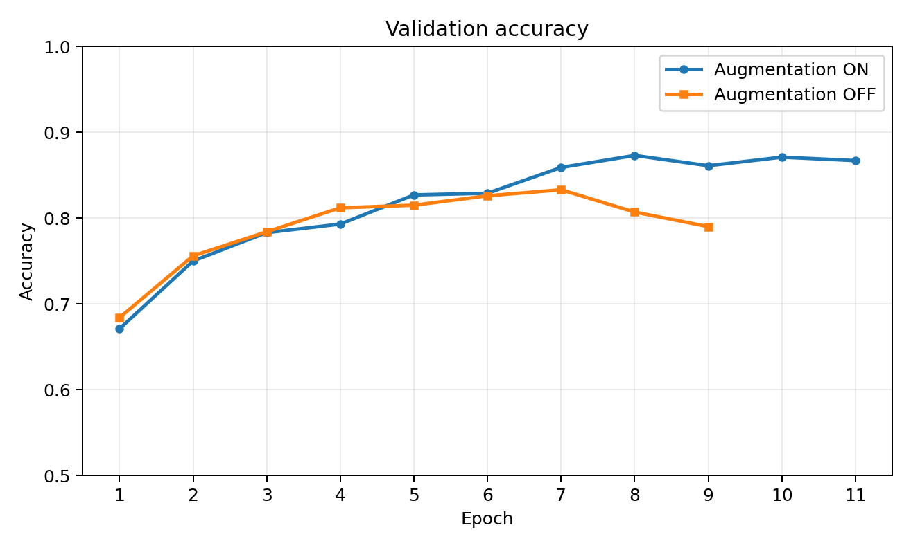
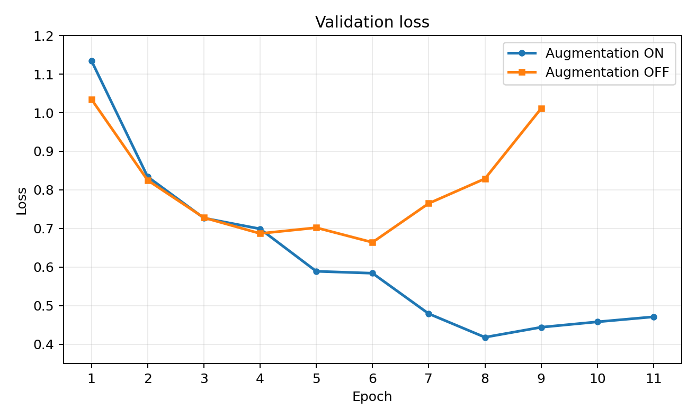
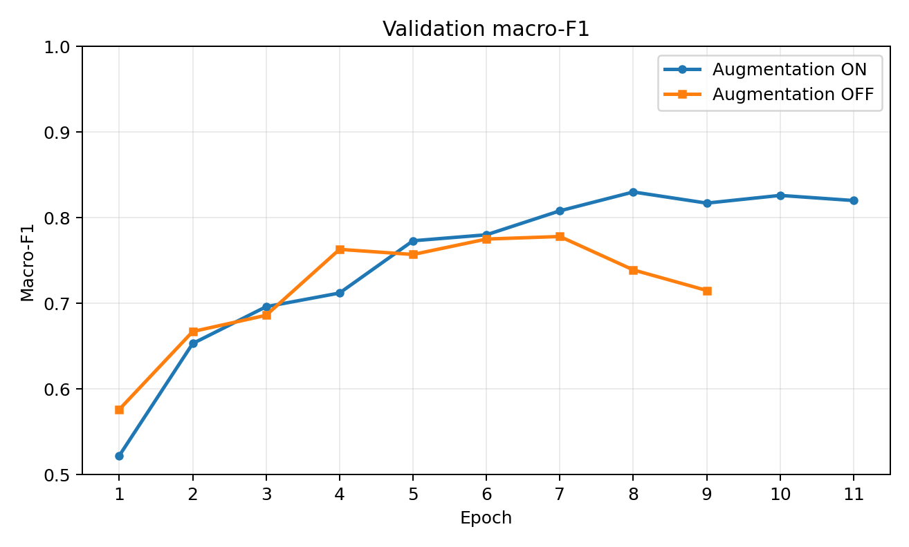

# SGP-45: Augmentation Comparison

## Setup

Compared augmentation ON and OFF using the wider BasicCNN (`[32, 64, 128]`). Both runs used 20% of PlantVillage, seed 42, image size 128, batch size 32, AdamW (lr 0.001, weight decay 0.01), and no input normalisation. Training was capped at 30 epochs with early stopping (`patience: 3`) based on validation loss.

ClearML runs: [ON](https://app.clear.ml/projects/93fd565121f041b38b7914098b4df984/tasks/7a8c606571274722bcf993129b71939c/output/log) · [OFF](https://app.clear.ml/projects/93fd565121f041b38b7914098b4df984/tasks/cc0bcce2d33d42bc902a1828c17a48d1/output/log)

## Results (best validation-loss epoch)

| Augmentation | Best epoch | Stopped at | Val accuracy | Val F1 | Val loss |
|---|---:|---:|---:|---:|---:|
| ON | 8 | 11 | **0.873** | **0.830** | **0.418** |
| OFF | 6 | 9 | 0.826 | 0.775 | 0.664 |

## Observations

- Augmentation improved validation accuracy by 4.7 percentage points and macro-F1 by 0.055 at the selected checkpoints.
- Without augmentation, training accuracy reached 0.980 by epoch 9 while validation accuracy dropped to 0.790, suggesting overfitting.
- Early stopping triggered for both runs before 30 epochs. Checkpoints are saved as ClearML artifacts.

## Recommendation

Keep augmentation enabled for the wider CNN based on these results.

## Limitations

Each setup was run once with seed 42 on 20% of the dataset. Results may differ with other seeds or the full dataset.