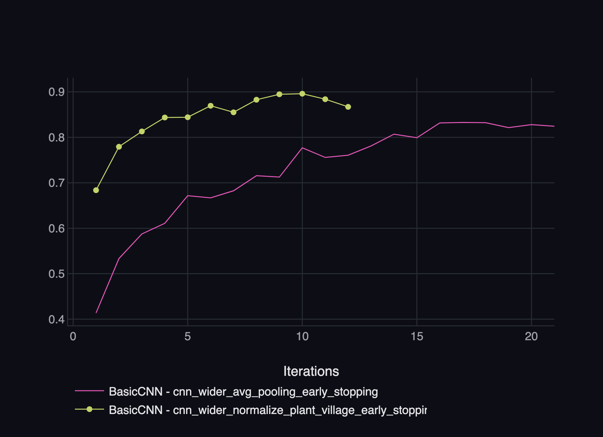
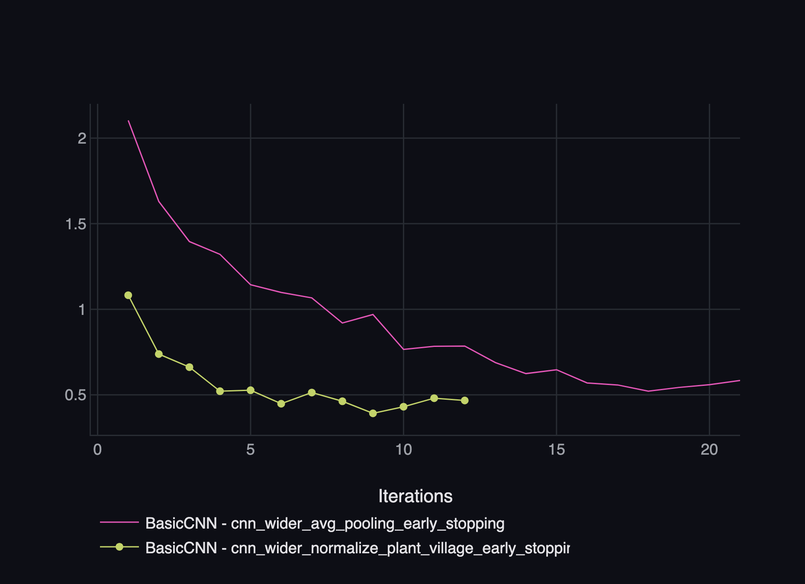
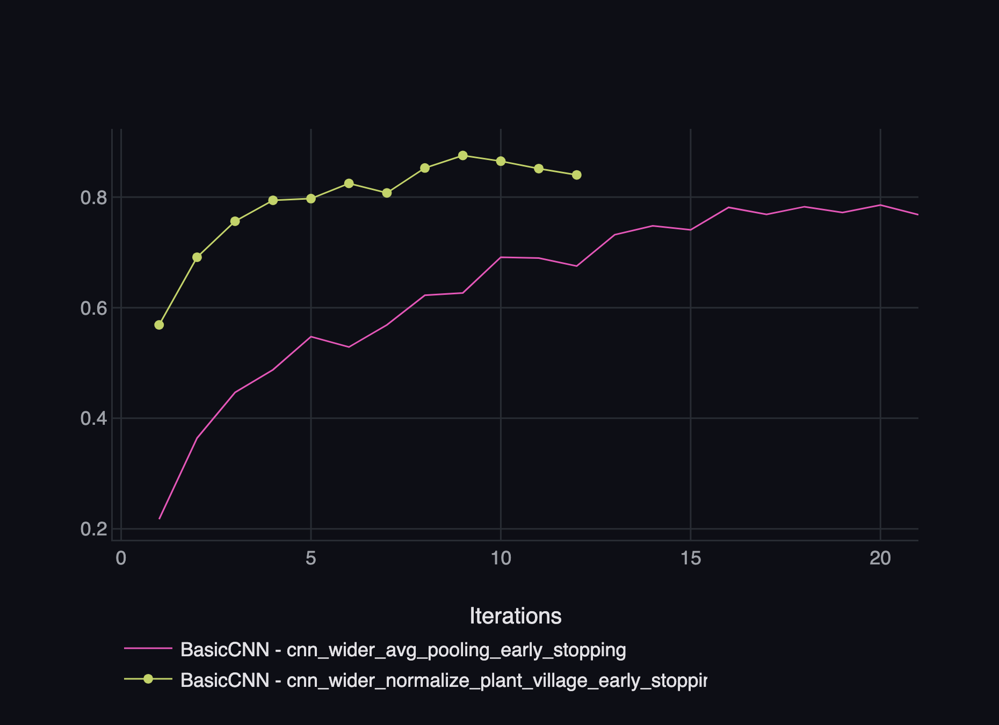

# SGP-51: Global Average Pooling for the Wider CNN

## Purpose

In the wider CNN (`[32, 64, 128]`, image size 128), the final Linear layer takes 128 × 16 × 16 = 32,768 inputs, so it holds 1,277,991 of the model's 1,371,239 parameters (about 93%). SGP-31 saw possible signs of overfitting, so this experiment tests whether replacing Flatten with global average pooling (GAP) reduces overfitting and how it affects accuracy.

## Setup

Both runs use the same training settings. The Flatten run uses `cnn_wider_normalize_plant_village_early_stopping.yaml` (from SGP-22), and the GAP config `cnn_wider_avg_pooling_early_stopping.yaml` is a copy of it with `pooling: avg` added, so the final layer is the only difference:

- Fraction 0.2, seed 42, image size 128, batch size 32, plant_village normalisation
- AdamW, lr 0.001, weight decay 0.01
- Up to 30 epochs with early stopping (patience 3); each run is compared at its lowest validation loss
- Both runs were trained on the same machine and tracked in ClearML (project `Plant-Disease-Image-Classification`): [ClearML comparison](https://app.clear.ml/projects/93fd565121f041b38b7914098b4df984/compare-tasks;ids=7d68ac7b6086499b83a96e390ac7bcad,0303978090ea4e1b864befae73ecce10/scalars/graph)

## Results (validation set, best epoch)

| Model | Config | Parameters | Best epoch | Stopped | Val accuracy | Val F1 | Val loss | Train accuracy | Time per epoch |
|---|---|---|---|---|---|---|---|---|---|
| Flatten | `cnn_wider_normalize_plant_village_early_stopping.yaml` | 1,371,239 | 9 | 12 | 0.895 | 0.875 | 0.392 | 0.937 | ~62 s |
| GAP | `cnn_wider_avg_pooling_early_stopping.yaml` | 98,279 | 18 | 21 | 0.832 | 0.783 | 0.521 | 0.831 | ~58 s |

The checkpoints are not committed to the repository. They are stored as artifacts (`final_checkpoint` and `best_checkpoint`) in each ClearML task.

## Observations

- **Accuracy.** Flatten performed better at its best epoch: 6.3 percentage points higher validation accuracy (0.895 vs 0.832), 9.2 points higher macro F1 (0.875 vs 0.783), and lower validation loss (0.392 vs 0.521).

- **Overfitting.** Flatten shows signs of overfitting: at its best epoch, training accuracy is 4.2 points above validation accuracy (0.937 vs 0.895), and by epoch 12 the gap grows to 8.7 points (0.954 vs 0.867), while validation loss rises from 0.392 to 0.467. GAP shows no clear signs of overfitting in this run: at its best epoch, training and validation accuracy are almost the same (0.831 vs 0.832).

- **Underfitting.** GAP shows less overfitting, but its lower training accuracy suggests possible underfitting. Its training loss stays around 0.5, close to its validation loss, while Flatten's training loss drops to 0.14. With only 128 values going into the final layer, the model has much less capacity. Averaging each feature map also removes information about where the disease patterns are in the image, which may explain the lower accuracy.

- **Training time.** GAP is only slightly faster per epoch (~58 s vs ~62 s), because most of the computation is in the convolutional layers. It needed twice as many epochs to reach its best result (18 vs 9), so the whole run took longer (about 20 minutes vs 13 minutes).

- **Model size.** GAP has about 14 times fewer parameters (98,279 vs 1,371,239), so its checkpoint is much smaller.