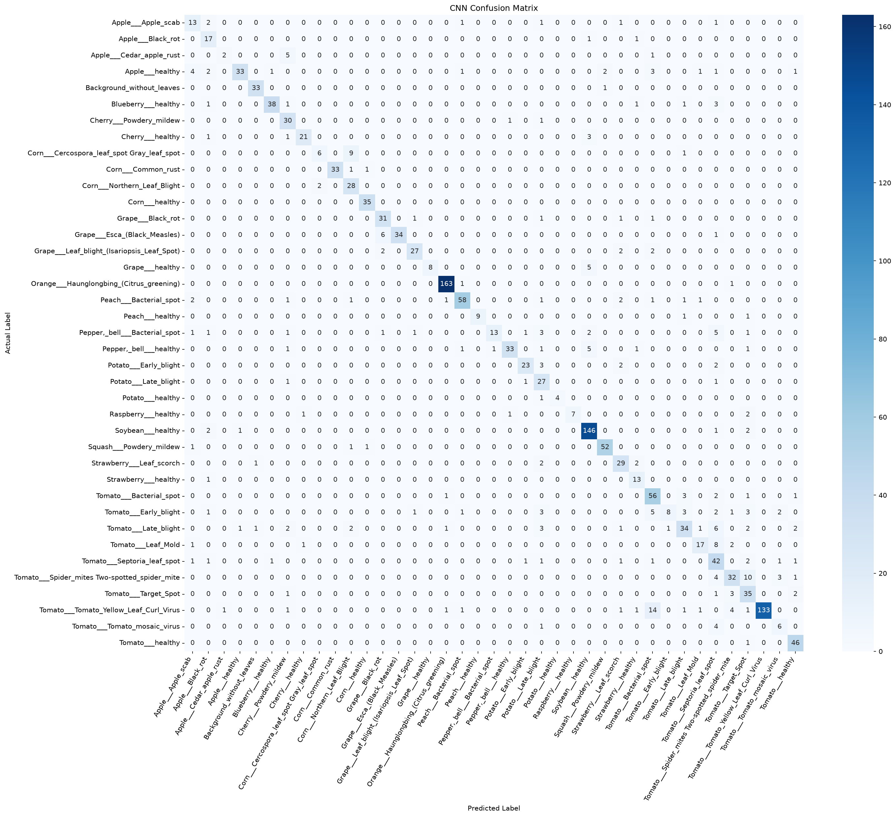
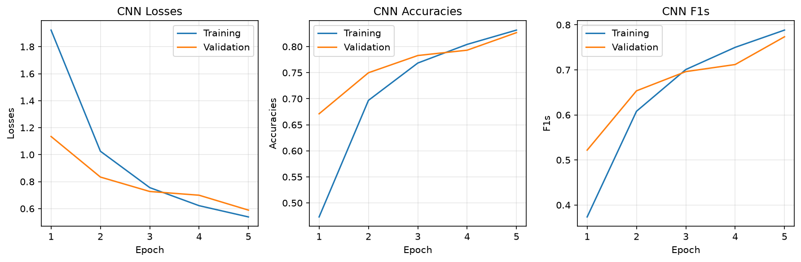

# SGP-15: CNN Architecture Comparison

## Setup
Within each run, all models use the same training settings so that only the architecture changes:
- Image size 128, batch size 32
- Run 1 uses 5% of PlantVillage (`fraction: 0.05`); Run 2 uses 20% (`fraction: 0.2`, same as `prototype.yaml`), so the results can be compared with the other models in the team.
- Training: 5 epochs, AdamW, lr 0.001, weight decay 0.01, seed 42

## Results (validation set, last epoch)
### Run 1: 5% of the data
| Model | Config | Channels | Parameters | Val accuracy | Val F1 | Checkpoint |
|---|---|---|---|---|---|---|
| Baseline | `prototype_small_data_frac.yaml` | [16, 32, 64] | 662,599 | 0.630 | 0.534 | `prototype_small_data_frac_20261106-101034_9934d5.pt` |
| Wider | `cnn_wider.yaml` | [32, 64, 128] | 1,371,239 | 0.668 | 0.566 | `cnn_wider_20261106-102850_dceb83.pt` |
| Deeper | `cnn_deeper.yaml` | [16, 32, 64, 128] | 416,967 | 0.572 | 0.454 | `cnn_deeper_20261106-103407_af0549.pt` |

Run 1 used the same wider and deeper configs with `fraction: 0.05`; they were later changed to `0.2` for Run 2. To reproduce Run 1, set `data.fraction` to `0.05` in the config.

### Run 2: 20% of the data

| Model | Config | Channels | Parameters | Val accuracy | Val F1 | Checkpoint |
|---|---|---|---|---|---|---|
| Baseline | `prototype.yaml` | [16, 32, 64] | 662,599 | 0.782 | 0.701 | `basiccnn_20261108-190231_d45e16.pt` |
| Wider | `cnn_wider.yaml` | [32, 64, 128] | 1,371,239 | 0.827 | 0.773 | `basiccnn_20261108-190708_c89b97.pt` |
| Deeper | `cnn_deeper.yaml` | [16, 32, 64, 128] | 416,967 | 0.776 | 0.698 | `basiccnn_20261108-191112_e0aa84.pt` |

## Observations
- About 96% of the baseline's parameters are in the final linear layer.
- The deeper model has fewer parameters than the baseline because each extra
  pooling layer halves the feature map size before the final linear layer.
- For the baseline, validation loss was still decreasing at epoch 5
  (1.570 → 1.371 → 1.208), so more epochs may improve it.
- The wider model improved validation accuracy by 3.8 points (0.630 → 0.668)
  and F1 by 3.2 points (0.534 → 0.566), but it has about twice as many parameters.
- For the wider model, validation loss increased slightly from epoch 4 to 5
  (1.114 → 1.138) while training loss kept decreasing, which may be an early
  sign of overfitting.
- The deeper model performed worst after 5 epochs (accuracy 0.572, F1 0.454),
  but its validation loss was still dropping quickly (1.809 → 1.680 → 1.405),
  so it is likely undertrained rather than a worse architecture. Deeper models
  often need more epochs to converge.
- **Run 2 (20% of the data):** every model scored 15–20 accuracy points higher than in Run 1. The two runs use different validation sets (the split is made from the sampled data), so this is only a rough sign that more data helps, not an exact measure.
- Unlike Run 1, the wider model's validation loss kept decreasing in Run 2 (0.727 → 0.699 → 0.589), so there was less sign of overfitting in this run. It is still the best model (accuracy 0.827, F1 0.773).
- The deeper model improved the most (+20.4 points, compared with +15.2 for the baseline) and now almost matches the baseline (0.776 vs 0.782) with 37% fewer parameters. This may mean the deeper model benefits more from additional data or longer training, but the two runs are not directly comparable.

## Limitations
- All models use the same training settings (5 epochs, lr 0.001). This keeps the
  comparison controlled, but it may not be the best setting for each architecture.
- Each result comes from a single run with one seed, so small differences (e.g. baseline vs deeper in Run 2) may not be significant.
- Run 2 checkpoints are named after the model type, so all three start with `basiccnn_`; the table records which file belongs to which config.

## Evaluation details (Run 2, validation set)

Each Run 2 checkpoint was evaluated with `evaluate.py` on the validation split. The test split was not used, so it is kept for the final model.

| Model | Top-1 | Top-3 | Top-5 | Macro precision | Macro recall | Macro F1 |
|---|---|---|---|---|---|---|
| Baseline | 0.782 | 0.926 | 0.969 | 0.790 | 0.689 | 0.701 |
| Wider | 0.827 | 0.946 | 0.974 | 0.820 | 0.770 | 0.773 |
| Deeper | 0.776 | 0.928 | 0.965 | 0.732 | 0.703 | 0.698 |

### Observations
- Top-3 accuracy is above 0.92 for all three models, meaning the correct disease is among the top 3 predictions for over 92% of validation images. This supports showing the top 5 predictions in the Gradio UI.
- The wider model's improvement comes mostly from recall (0.689 → 0.770). Some classes the baseline mostly missed improved a lot, e.g. Apple scab (0.16 → 0.68) and Tomato Leaf Mold (0.17 → 0.59).
- The deeper model reaches about the same accuracy and macro F1 as the baseline with around 37% fewer parameters (416,967 vs 662,599), but its macro precision is lower (0.732 vs 0.790).
- Some classes are weak for all three models, e.g. Tomato Early blight (recall 0.23 / 0.27 / 0.30). Corn Cercospora leaf spot got worse with the bigger models (0.62 / 0.38 / 0.19), and the deeper model did not correctly classify any of the 8 Cedar apple rust validation images.
- Accuracy is higher than macro F1 for every model. Large classes such as Orange Haunglongbing (165 images) and Soybean healthy (152) score well, while many small classes score lower, so class imbalance pulls macro F1 down.

### Confusion matrix and training curves

- Most errors happen between tomato diseases. For the wider model, Tomato Leaf Mold was predicted as Septoria leaf spot 8 times (out of 29), Spider mites as Target Spot 10 times (out of 50), and Yellow Leaf Curl Virus as Bacterial spot 14 times (out of 160).
- Septoria leaf spot collects many wrong predictions from other tomato classes, which explains its low precision (0.50).

- Validation accuracy and F1 were still increasing at epoch 5, and the training and validation curves stay close, so there is no sign of overfitting. The wider model is probably undertrained, so training it for more epochs is a reasonable next step.

The confusion matrices and training curves for all three models are in `documents/experiments/figures/`.

### Deeper model: confusion matrix and training curves
- It never predicted Cedar apple rust. Of the 8 validation images, 4 were predicted as Orange Huanglongbing and 3 as Potato Late blight.
- Its low precision for Grape healthy (0.36) comes mainly from Soybean healthy: 11 of the 152 Soybean images were predicted as Grape healthy.
- Corn Cercospora leaf spot was mostly confused with Corn Northern Leaf Blight (9 of 16 images). These wrong predictions lower Northern Leaf Blight's precision (0.71).
- The training curves look similar to the wider model: no sign of overfitting, and validation scores were still improving at epoch 5.

### Baseline model: confusion matrix and training curves

- Many wrong predictions go to two classes. Tomato Yellow Leaf Curl Virus receives predictions from other tomato diseases (e.g. 11 Bacterial spot, 9 Spider mites and 7 Early blight images), and Blueberry healthy receives 10 Septoria leaf spot and 6 Apple healthy images. This explains their low precision (0.72 and 0.57).
- Tomato Leaf Mold was mostly predicted as Peach Bacterial spot (10 of 29 images), and only 5 were correct.
- Unlike the wider model, validation accuracy stops improving after epoch 4 and validation F1 drops slightly at epoch 5, while training loss keeps decreasing. The baseline seems to reach its limit earlier than the wider model.

### Notes
- Some classes have very few validation images (Potato healthy has 5, Cedar apple rust has 8), so per-class results for them can change a lot between runs.
- The reports are in `outputs/eval_reports/` (gitignored): baseline `validation_2026-11-08_20-17-57`, wider `validation_2026-11-08_20-19-30`, deeper `validation_2026-11-08_20-23-24`.
- `evaluate.py` was run with positional arguments, before SGP-20 (#36) switches it to argparse.