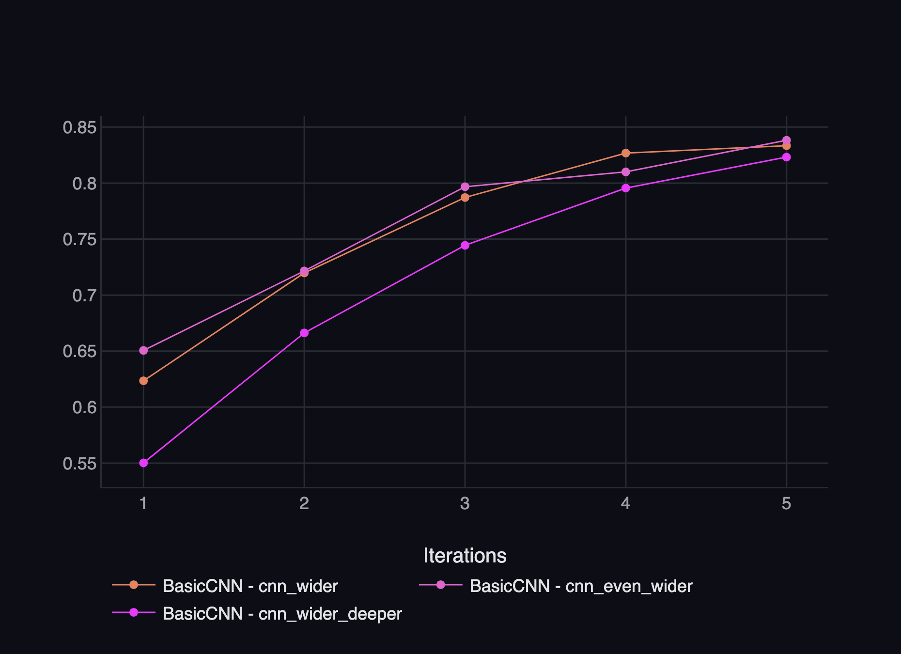
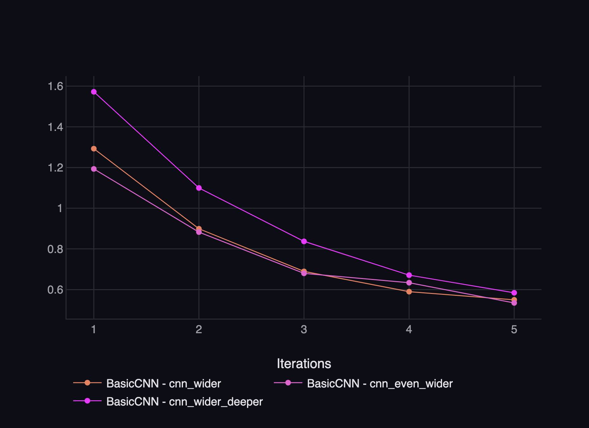
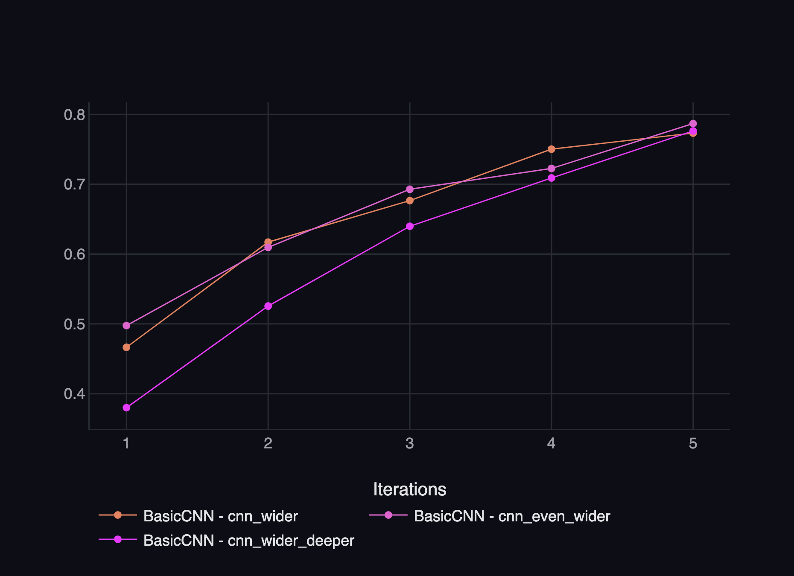

# SGP-40: Wider CNN Variants on ClearML

## Setup

All three models use the same settings agreed in #main-discussions, so only the channels change:

- Fraction 0.2, seed 42, image size 128, batch size 32
- 5 epochs, AdamW, lr 0.001, weight decay 0.01
- All runs were tracked in ClearML (project `Plant-Disease-Image-Classification`): [ClearML comparison](https://app.clear.ml/projects/93fd565121f041b38b7914098b4df984/compare-tasks;ids=b81a07a8dea94c2b9560d4589b6bdd3e,ddda6b13d5fc40e3b9e04024c932429d,d9572589657f4fe795da83688ca7ad5b/scalars/graph)

## Results (validation set, last epoch)

| Model | Config | Channels | Parameters | Val accuracy | Val F1 | Val loss | Checkpoint |
|---|---|---|---|---|---|---|---|
| Wider | `cnn_wider.yaml` | [32, 64, 128] | 1,371,239 | 0.833 | 0.773 | 0.550 | `basiccnn_20261111-234519_53b550.pt` |
| Even wider | `cnn_even_wider.yaml` | [64, 128, 256] | 2,926,759 | 0.838 | 0.787 | 0.534 | `basiccnn_20261111-232941_67ac4e.pt` |
| Wider + deeper | `cnn_wider_deeper.yaml` | [32, 64, 128, 256] | 1,027,431 | 0.823 | 0.776 | 0.584 | `basiccnn_20261111-234033_42be13.pt` |

The checkpoints are not committed to the repository. They are stored as artifacts (`final_checkpoint` and `best_checkpoint`) in each ClearML task.

## Observations

- Even wider got the best results, with 0.5 percentage points higher accuracy and 1.4 percentage points higher F1 than wider. However, it has about twice as many parameters, a larger checkpoint (11.7 MB vs 5.5 MB), and took about twice as long to train.
- Wider and even wider performed very similarly during training. Their curves are close and sometimes cross, so it is hard to say if even wider is actually better based on just one run.
- Wider + deeper has about 25% fewer parameters than wider because the extra pooling layer makes the feature map smaller before the final linear layer. It had the highest validation loss at the start (1.572), but improved to 0.584 by epoch 5. Its F1 was also slightly better than wider (0.776 vs 0.773).
- Validation loss was still going down at epoch 5 for all three models. There is no obvious overfitting so far, and training for more epochs might give better results.

## Recommendation

- For now, I think wider `[32, 64, 128]` is the better choice for the team. Even wider performed slightly better, but the difference is small compared to its larger size and longer training time.
- As a next step, we could train wider and wider + deeper for more than 5 epochs. Both were still improving, and wider + deeper was catching up with the other models.

## Limitations

- Each model was only trained once with one seed, so the results might change with another run.
- Wider got slightly different results compared to SGP-15 (accuracy 0.833 vs 0.827, while F1 stayed at 0.773), even though the settings and seed were the same. This is because ClearML's `Task.init` sets its own seed (1337), so the training batches are shuffled in a different order. 
- I didn't use `evaluate.py` because its results are not logged to ClearML yet (SGP-33). The metrics in this report come from the training history saved in the checkpoints.
